# Floorsight

**Floor-distance forklift safety from the cameras a site already has: it slows or stops the forklift before it
reaches a person, then an agent double-checks the warning and a person makes the final call.** Built for the OpenCV AI
Competition 2026 on OpenCV 5 and AWS.

  

  <b>▶ <a href="https://tonystark101-debug.github.io/floorsight/">Watch every video in your browser</a></b> ·
  <a href="https://tonystark101-debug.github.io/floorsight/#demo">Play the demo (4 min 22 s, narrated, captions)</a> ·
  <a href="videos/README.md">Video list</a> ·
  <a href="docs/report/Floorsight-Technical-Report-v0.5-20261024.md">Technical report</a>

> Status (24 Oct 2026): runs end to end on six real factory clips, privately on AWS Graviton4 with the Cloud
> Optimized OpenCV (COOL) build, and in a closed loop in a simulated warehouse. One camera, development clips, not
> field-validated. Every number below comes from a receipt in `docs/receipts/`.

**Live demo for the judges:** the app runs on our private AWS deployment; we run it live for the judges by
screen-share on request (a temporary public HTTPS link is one Terraform variable away, `docs/aws/DEPLOY.md`).

Every preview on this page is a moving GIF of a real output; click it to play the full video in your browser.

## For the judges: every requirement, one click away

| Requirement | Where |
|---|---|
| Technical report | [`docs/report/Floorsight-Technical-Report-v0.5-20261024.md`](docs/report/Floorsight-Technical-Report-v0.5-20261024.md) (problem and users, architecture, OpenCV 5 implementation, AWS, evaluation, limitations, responsible use) |
| Code, pinned dependencies, build / deploy / test instructions | this repository; [`requirements.txt`](requirements.txt) (pinned); [Run it](#run-it) below; [`docs/aws/DEPLOY.md`](docs/aws/DEPLOY.md) |
| Architecture diagram (OpenCV 5, AWS, COOL, agent) | [`docs/diagrams/floorsight-architecture-20261026.png`](docs/diagrams/floorsight-architecture-20261026.png) |
| Working endpoint or live demo | live screen-share on request; every recorded run plays at the [video page](https://tonystark101-debug.github.io/floorsight/) |
| Video, at most 5 minutes | [the demo, 4 min 22 s](https://tonystark101-debug.github.io/floorsight/#demo) |
| Evaluation, failure cases, limitations | [Honest results](#honest-results) and [Limits](#limits) below; report sections 9 and 11; every number has a receipt in [`docs/receipts/`](docs/receipts/) |
| COOL: version and AWS configuration | [`docs/receipts/cool-opencv-build-20261023.txt`](docs/receipts/cool-opencv-build-20261023.txt): OpenCV 5.1.0-dev from `/opt/cool` on the COOL Marketplace AMI, EC2 `c8g.xlarge` (Graviton4) |
| COOL: reproducible evaluation against a baseline | [`docs/receipts/cool-bench-20261024.json`](docs/receipts/cool-bench-20261024.json), report section 10: same instance, same code, same real frames, COOL against stock OpenCV |
| COOL: evidence it runs the claimed workload | the perception runs on AWS imported OpenCV from the COOL build: each per-clip result records it (final run: OpenCV 5.1.0-dev from `/opt/cool/python_3.12/site-packages/cv2`); the `cv2.fillPoly` crash we found happens in COOL, not in stock OpenCV ([`docs/findings/COOL-fillPoly-crash.md`](docs/findings/COOL-fillPoly-crash.md)) |
| Agentic: workflow diagram (perception, decision, action) | [`docs/diagrams/floorsight-agent-workflow-20261026.png`](docs/diagrams/floorsight-agent-workflow-20261026.png) |
| Agentic: trace where OpenCV output changes a later decision | [`docs/receipts/traces/`](docs/receipts/traces/README.md): the agent rejects a warning because the floor measurements show a tracking glitch, and no alert is sent |
| Agentic: task success, failure handling, observability, human control | report section 6; [`docs/receipts/app-run-09-summary-20261024.json`](docs/receipts/app-run-09-summary-20261024.json); a person approves every alert |

## How it works: one camera frame, start to finish

| | Step | What happens | Evidence |
|---|---|---|---|
| 1 | **See** | Frames from the CCTV a site already has. No new cameras, no tags on people. | six real factory clips |
| 2 | **Hide faces first** | Heads and faces are pixelated before anything is stored or shown. If the filter fails, the frame is black. | 98 % of 2,636 heads covered |
| 3 | **Find** | Detectors find people, forklifts and the loads they carry. | RT-DETRv2, Grounding DINO, SlimSAM |
| 4 | **Measure in metres** | OpenCV 5 finds the floor's lines, works out where the camera hangs, and puts every person and forklift on a floor plan in metres, with an error bar. | camera 3.56 m up, ±5 % |
| 5 | **Steady the dots** | Kalman filters remove detector jitter so a shaky outline does not look like a swerve. | heading swings 53 → 11 |
| 6 | **Predict** | Each moving forklift gets a danger zone: stopping distance, tail swing, the blind zone behind its load. Within 0.8 m of a person in the next 3 s means WARNING. | 64 sampled variations per frame |
| 7 | **Act** | A confirmed warning slows the forklift to walking pace; a person in its path stops it; someone walking into its back sounds the horn. It resumes only when the person is *seen* clear. | simulator: 2 of 2 in-path contacts prevented |
| 8 | **Agent double-checks** | Replays the last 1.5 s, zooms in, re-measures with a second detector, recommends confirm or reject in one line. | rejected a warning built on a tracking glitch |
| 9 | **A person decides** | Approves or rejects; only approved warnings reach the floor lead (Amazon SNS). Every step goes into a trace. | 29 trace steps in the final run |

Steps 1-7 run automatically inside one frame; steps 8-9 happen afterwards and decide what the warning was, not
whether to brake.

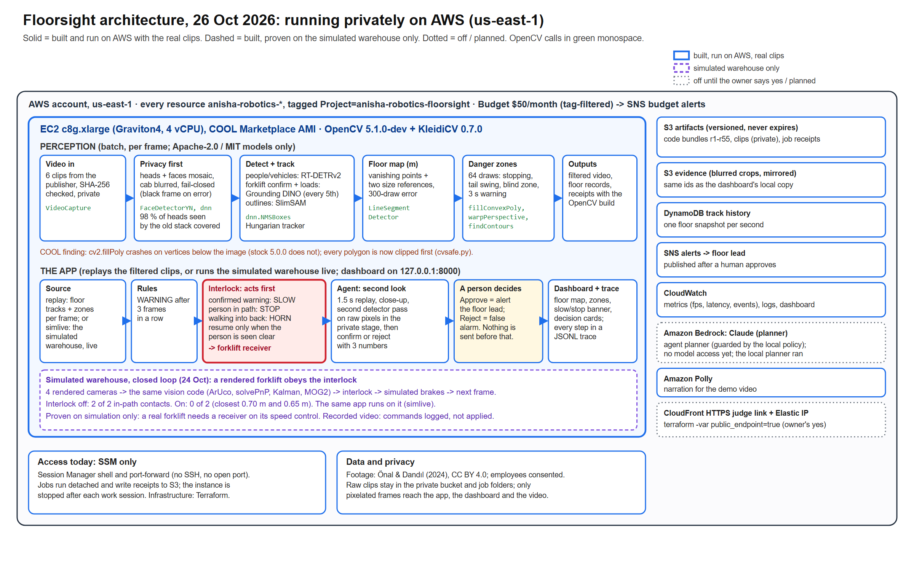

### The agent loop: perception, decision, action

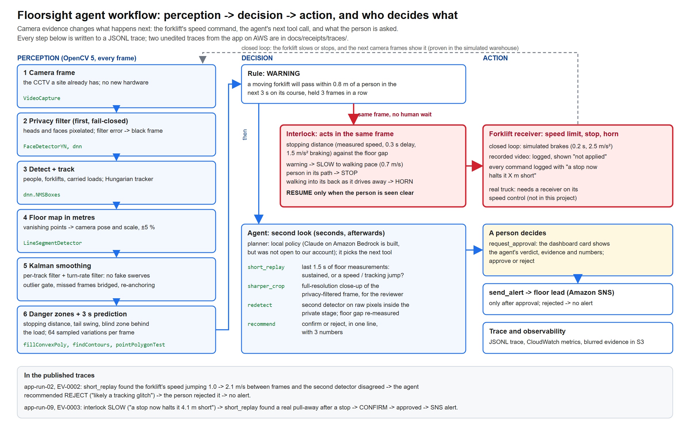

The camera evidence decides what happens next: the interlock's speed command in the same frame, then the agent's next
tool call and its recommendation, then what the person is asked. Two unedited traces from the app on AWS, with a
step-by-step reading: [`docs/receipts/traces/`](docs/receipts/traces/README.md).

## See it working

### Pixels lie, the floor map does not

<table>
<tr>
<td width="50%">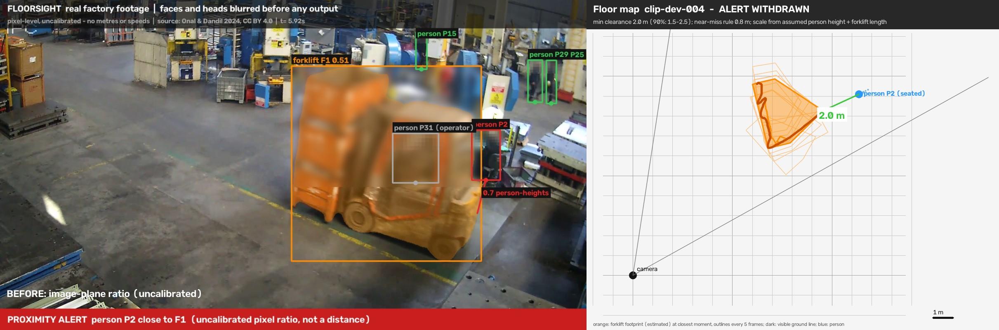</td>
<td width="50%">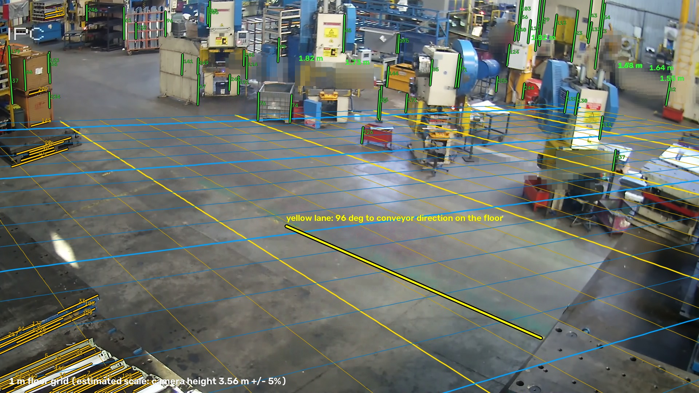</td>
</tr>
<tr>
<td>On screen the seated operator seems to touch the forklift (left); on the floor map they are 2.0 m apart (right). A pixel rule would alarm all day.</td>
<td>The 1 m floor grid OpenCV 5 recovers from one ordinary camera, drawn back onto the image; green: height checks on people and machines.</td>
</tr>
</table>

### Simulated warehouse: the forklift interlock off and on

Recorded video cannot be braked, so we built a simulated warehouse whose forklift obeys Floorsight: four rendered
cameras, the same vision code, the same stop logic. 40 s each, shown at 4x.

<table>
<tr>
<td width="50%"><a href="https://tonystark101-debug.github.io/floorsight/#sim-off">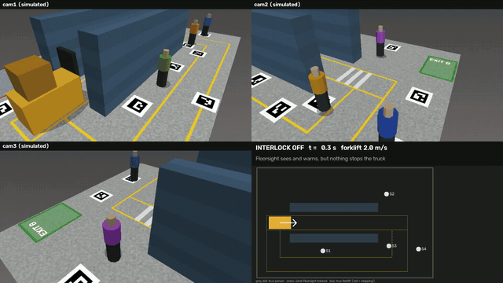</a></td>
<td width="50%"><a href="https://tonystark101-debug.github.io/floorsight/#sim-on">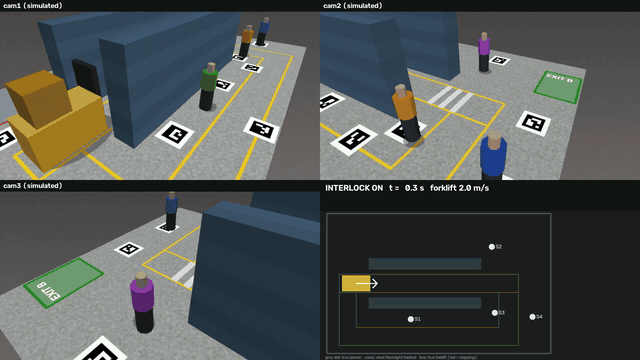</a></td>
</tr>
<tr>
<td><b>Interlock OFF:</b> Floorsight sees the people, nothing brakes, the forklift reaches both people who step into its path.</td>
<td><b>Interlock ON:</b> it slows, stops, waits until each person is seen clear, and passes them at 0.70 m and 0.65 m.</td>
</tr>
</table>

| Situation | Interlock off | Interlock on |
|---|---|---|
| Person steps into the path | contact | no contact (0.70 m) |
| Person crosses ahead | contact | no contact (0.65 m) |
| Person walks alongside | no conflict | no stop for them |
| Person walks into the back of a forklift driving away | contact | contact: braking cannot help |

The cost: 27 m driven in 40 s instead of 80 m. Testing in the loop found 6 real bugs, each fixed and now a test.

### The app

<table>
<tr>
<td width="50%"><a href="https://tonystark101-debug.github.io/floorsight/#app-real">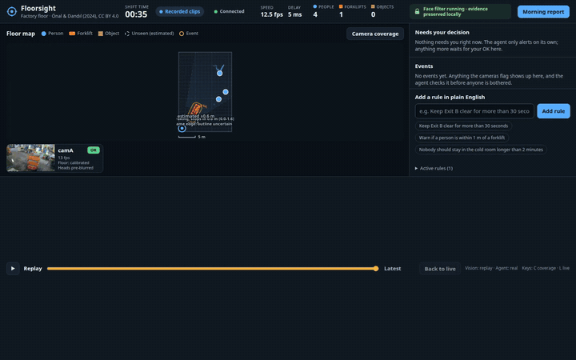</a></td>
<td width="50%"><a href="https://tonystark101-debug.github.io/floorsight/#app-sim">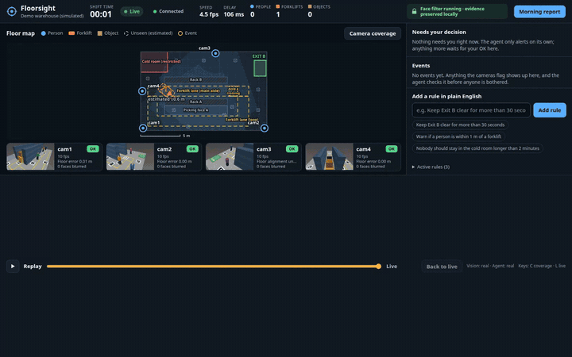</a></td>
</tr>
<tr>
<td><b>Real clips</b> (3 min 7 s): AUTO-STOP, then RESUME once the way is clear ("a stop now halts it 2.2 m short"; recorded video, so logged, not applied), the agent's recommendation, approve/reject, alerts.</td>
<td><b>Simulated warehouse</b> (1 min 58 s): the same app on four cameras, issuing AUTO-SLOW, AUTO-STOP and RESUME at the same moments as the closed-loop test.</td>
</tr>
</table>

### Real factory clips, measured on the floor

Final run on AWS (24 Oct): Kalman-smoothed tracks and forklift danger zones drawn on each clip. Shown at 1.5x.

<table>
<tr>
<td width="33%"><a href="https://tonystark101-debug.github.io/floorsight/#overlay-clip-dev-002">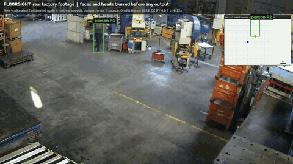</a> clip-dev-002: 2 warnings (in the app: slow, stop, resume)</td>
<td width="33%"><a href="https://tonystark101-debug.github.io/floorsight/#overlay-clip-dev-003">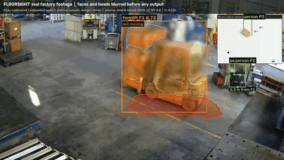</a> clip-dev-003: 1 warning as the forklift pulls away (in the app: auto-slow)</td>
<td width="33%"><a href="https://tonystark101-debug.github.io/floorsight/#overlay-clip-dev-004">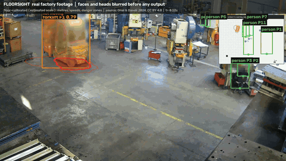</a> clip-dev-004: closest 2.83 m, no warning</td>
</tr>
<tr>
<td><a href="https://tonystark101-debug.github.io/floorsight/#overlay-screen-002">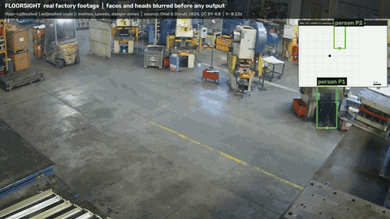</a> screen-002: the hardest clip, closest 1.55 m</td>
<td><a href="https://tonystark101-debug.github.io/floorsight/#overlay-screen-032">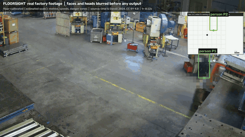</a> screen-032</td>
<td><a href="https://tonystark101-debug.github.io/floorsight/#overlay-screen-033">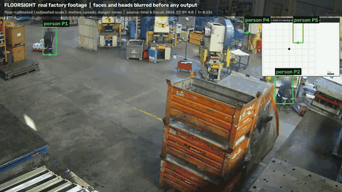</a> screen-033</td>
</tr>
</table>

### Smoothing: raw against Kalman-filtered

<a href="https://tonystark101-debug.github.io/floorsight/#smoothing">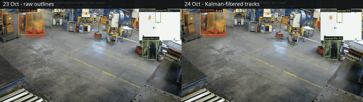</a> 
Same clip, same detections. Left: raw outlines. Right: Kalman-filtered tracks. Outline jitter down 50-80 % per clip;
"turning" flips 94 → 2; one-frame warning blips 8 → 0.

### Privacy first, fail-closed

What the rest of the system is allowed to see: the clips after the privacy filter only, heads and faces pixelated.

<table>
<tr>
<td width="33%"><a href="https://tonystark101-debug.github.io/floorsight/#filtered-clip-dev-002">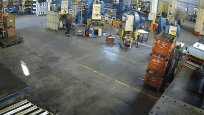</a></td>
<td width="33%"><a href="https://tonystark101-debug.github.io/floorsight/#filtered-clip-dev-003">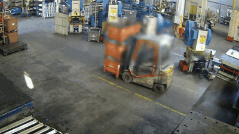</a></td>
<td width="33%"><a href="https://tonystark101-debug.github.io/floorsight/#filtered-clip-dev-004">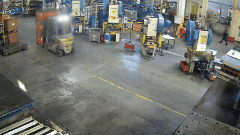</a></td>
</tr>
<tr>
<td><a href="https://tonystark101-debug.github.io/floorsight/#filtered-screen-002">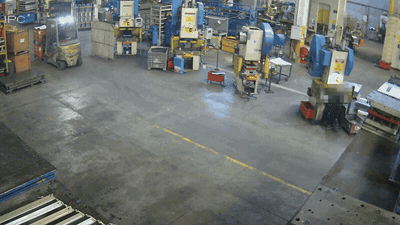</a></td>
<td><a href="https://tonystark101-debug.github.io/floorsight/#filtered-screen-032">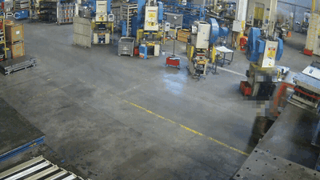</a></td>
<td><a href="https://tonystark101-debug.github.io/floorsight/#filtered-screen-033">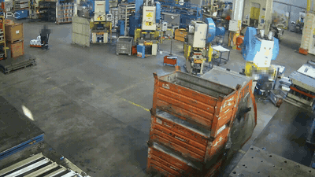</a></td>
</tr>
<tr>
<td><a href="https://tonystark101-debug.github.io/floorsight/#fail-closed">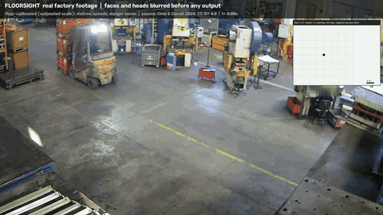</a></td>
<td colspan="2"><b>Fail-closed test</b> (left, slowed down): on frames 4 and 8 the face filter is forced to fail, and those frames come out black and marked withheld. A fail-closed self-test also runs on every perception run.</td>
</tr>
</table>

### Measured twice, and COOL against stock OpenCV

<table>
<tr>
<td width="50%">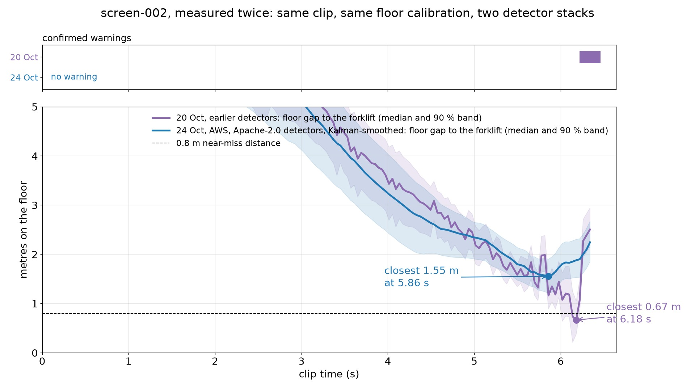</td>
<td width="50%">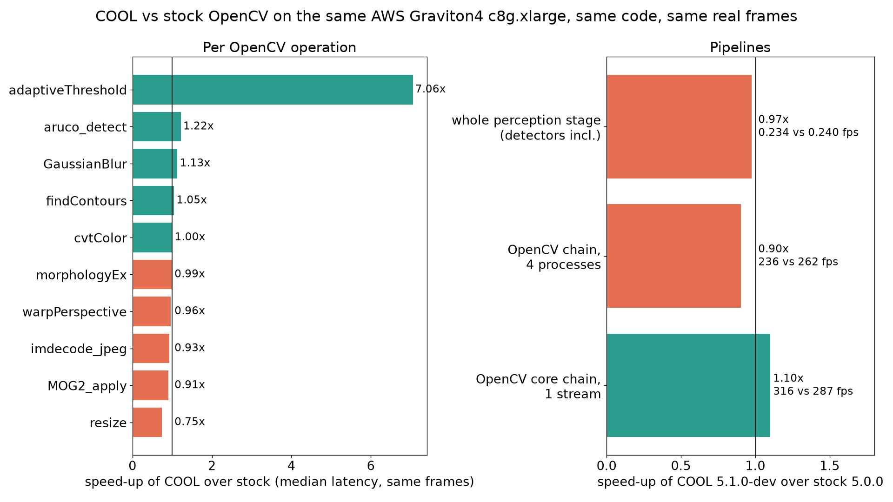</td>
</tr>
<tr>
<td>Our hardest clip, measured with the earlier and the publishable detectors: we show both instead of the flattering one.</td>
<td>COOL against stock OpenCV on the same Graviton4 instance and frames: big wins on some functions, 0.97x end to end.</td>
</tr>
</table>

<b>Earlier versions (17-24 Oct), kept for the record: superseded, some numbers corrected later</b>

 

<table>
<tr>
<td width="33%"><a href="https://tonystark101-debug.github.io/floorsight/#cameras-demo_001">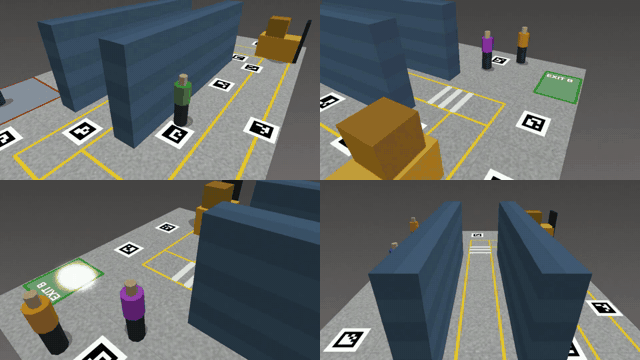</a> 17 Oct: the four rendered cameras of the first simulated scenario (6x)</td>
<td width="33%"><a href="https://tonystark101-debug.github.io/floorsight/#e-2026-10-17-simulator-tracking">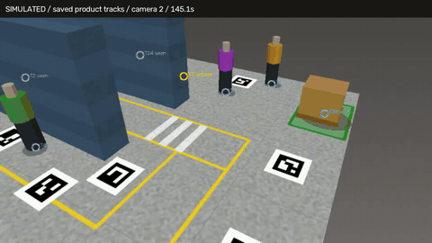</a> 17 Oct: multi-camera tracking in the simulator</td>
<td width="33%"><a href="https://tonystark101-debug.github.io/floorsight/#e-2026-10-17-simulator-region-history">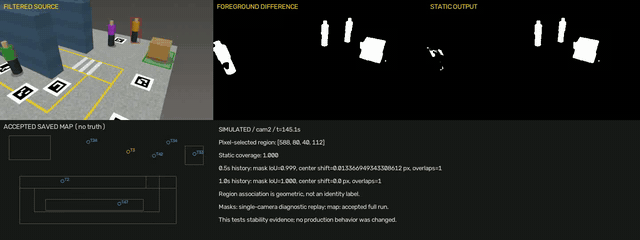</a> 17 Oct: region history in the simulator</td>
</tr>
<tr>
<td><a href="https://tonystark101-debug.github.io/floorsight/#e-2026-10-19-clip-dev-001-overlay">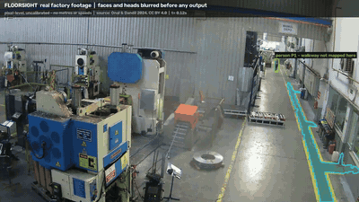</a> 19 Oct: clip-dev-001, earlier detector stack</td>
<td><a href="https://tonystark101-debug.github.io/floorsight/#e-2026-10-19-clip-dev-002-overlay">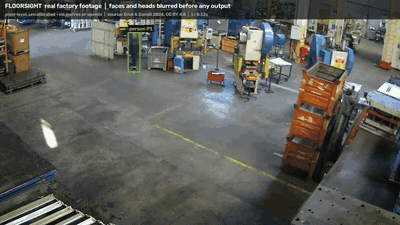</a> 19 Oct: clip-dev-002, earlier detector stack</td>
<td><a href="https://tonystark101-debug.github.io/floorsight/#e-2026-10-19-clip-dev-004-overlay">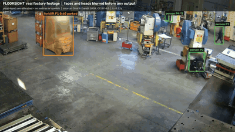</a> 19 Oct: clip-dev-004, earlier detector stack</td>
</tr>
<tr>
<td><a href="https://tonystark101-debug.github.io/floorsight/#e-2026-10-20-clip-dev-004-zone">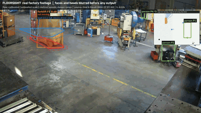</a> 20 Oct: first danger zones, clip-dev-004</td>
<td><a href="https://tonystark101-debug.github.io/floorsight/#e-2026-10-20-screen-002-zone">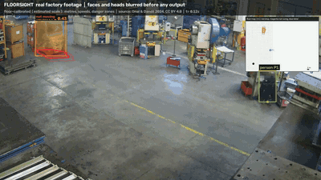</a> 20 Oct: first danger zones, screen-002</td>
<td><a href="https://tonystark101-debug.github.io/floorsight/#e-2026-10-20-screen-002-swerve-halfspeed">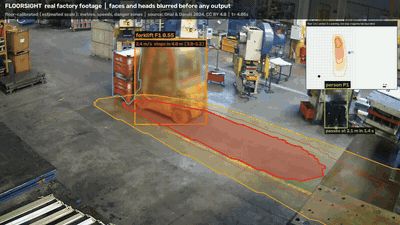</a> 20 Oct: the swerve, half speed (warning 0.04 s too late)</td>
</tr>
<tr>
<td><a href="https://tonystark101-debug.github.io/floorsight/#e-2026-10-21-app-run">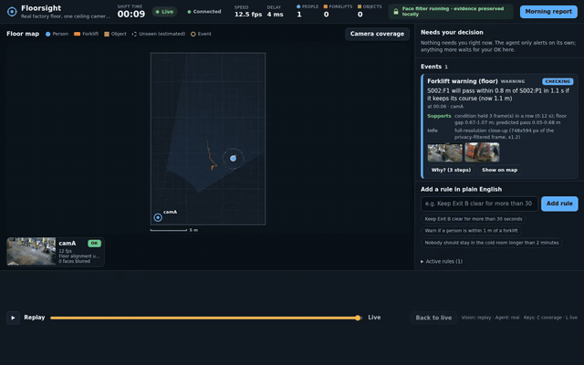</a> 21 Oct: first app run on the real clips</td>
<td><a href="https://tonystark101-debug.github.io/floorsight/#e-2026-10-24-demo-draft-1">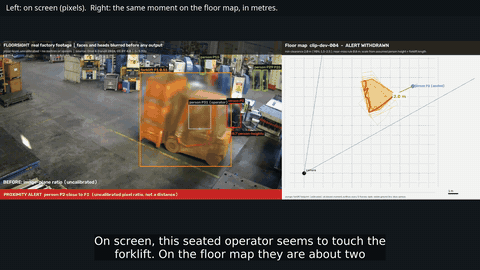</a> 24 Oct: demo draft 1</td>
<td><a href="https://tonystark101-debug.github.io/floorsight/#e-2026-10-24-demo-draft-2">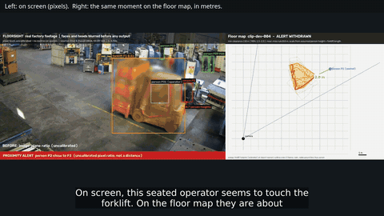</a> 24 Oct: demo draft 2</td>
</tr>
<tr>
<td colspan="3">The final numbers are in the demo and in report v0.5. For example, screen-002 no longer warns once the turn-rate noise is filtered.</td>
</tr>
</table>

## What it does

1. **Floor map in metres from one ordinary camera.** OpenCV's line-segment detector finds the floor's directions;
   vanishing points give the camera's pose; two independent size references (people, the forklift) fix the scale,
   with its error. Every person and forklift becomes a point on the floor.
2. **Forklift danger zones, each with its error.** Stopping distance from the measured speed, tail swing in turns,
   and the driver's blind zone behind a tall load, from 64 sampled variations per frame.
3. **A 3-second early warning.** If a moving forklift will pass within 0.8 m of a person in the next 3 s on its
   current course, the dashboard shows CHECKING, then WARNING once the condition holds for 3 frames.
4. **The machine acts first.** The moment a warning is confirmed, the forklift is slowed to walking pace, or stopped
   if the person is in its path, without waiting for anyone (`floorsight/interlock.py`); it resumes only when the
   person is seen clear. Proven in a closed loop in the simulated warehouse (`scripts/interlock_sim.py`); a real truck
   needs a receiver on its speed control; on recorded video the command is logged, not applied.
5. **An agent that double-checks every warning afterwards.** It replays the last 1.5 s of floor
   measurements, takes a close-up, and re-measures the gap with a second detector pass. It then recommends confirm
   or reject in one line with three numbers. **A person approves or rejects; nothing reaches the floor lead without
   that.** Every step is written to a trace as it happens.
6. **Privacy first, fail-closed.** Heads and faces are pixelated before any frame is stored or shown. If the filter
   fails, the frame is black (tested on every run). Raw clips never leave a private store.

## Honest results

- Simulated warehouse, closed loop (`docs/receipts/interlock-sim-20261024.json`): without the interlock the forklift
  hit both people who stepped into its path; with it, it stopped and passed them at 0.70 and 0.65 m. It cannot help a
  person who walks into the back of a forklift driving away, or anyone no camera sees (our first layout put a picker in
  an aisle only one camera covers, and the forklift itself blocked that view), and it cost two thirds of the
  forklift's distance in 40 s. The simulated people do not react.
- Pixel distance lies: two "near misses" in the footage were about 2 m apart on the floor. Both were withdrawn.
- The key clip, measured twice. With our earlier detectors (20 Oct) the forklift's outline swerved toward a seated
  operator in its last 40 ms: 0.67 m, and the warning came 0.04 s *after* the closest moment. With the publishable
  detectors on AWS and Kalman-filtered tracks (24 Oct) the same clip never comes closer than 1.55 m, and Floorsight
  does not warn. Our 23 Oct runs did warn here, about 2 s early, but those warnings came from a brief 0.2 rad/s "turn"
  toward the operator that the new turn-rate filter shows was noise: the forklift drove straight. With one camera we
  cannot say which outline is right: at the swerve instant the two disagree by about 1.2 m. Either way, no warning
  based on a forklift's course can foresee a real swerve. Chart: `docs/report/figures/screen-002-measured-twice.jpg`.
- In the final app run on AWS (24 Oct, with smoothing and the interlock): Floorsight slowed, stopped and then resumed
  the forklift on clip-dev-002 ("a stop now halts it 2.2 m short"; recorded video, so logged, not applied); 3 warnings
  on 2 clips; the agent recommended confirm for all 3, one of them a forklift pulling away from a stop in a new
  direction, which it now tells apart from a tracking glitch; the reviewer, a scripted stand-in that follows the agent,
  approved them; 3 alerts on SNS; 29 trace steps (`docs/receipts/app-run-09-summary-20261024.json`). The earlier run before smoothing had 4 warnings and the agent
  rejected one built on a tracking glitch (`docs/receipts/app-run-02-summary-20261024.json`). A confirmed warning is a
  prediction on the forklift's course: in these runs the driver turned or the clip ended before a close pass.
- Reviewing our own demo video frame by frame showed jumpy zones. Every floor track now runs through a Kalman filter,
  and a constant-turn-rate Kalman filter decides when a forklift is turning. On the same saved detections: outline
  jitter down 50-80 % per clip, sudden heading swings 53 → 11, "turning" flips 94 → 2, one-frame warning blips 8 → 0
  (`docs/receipts/motion-noise-before-after-20261024.json`; report section 4b).
- Replacing our earlier AGPL-3.0 detectors with Apache-2.0 ones: on 60 real frames RT-DETRv2 finds 97 % of the people
  and 98 % of the forklifts the old stack found (93 % / 89 % at the thresholds we run, before tiling and tracking), and
  the new privacy stage pixelates 98.0 % of the 2,636 heads the old stack saw; one real gap, the top of one head in two
  frames, no face visible (`docs/receipts/privacy-manual-review-20261024.md`). Floor results per clip, old vs new:
  `docs/receipts/floor-compare-aws-run3-vs-20oct.json`.
- COOL vs stock OpenCV on the same Graviton4 instance and frames: `adaptiveThreshold` 7.06x, `GaussianBlur` 1.13x,
  one stream of our OpenCV chain 1.10x; `resize` 0.75x, four processes 0.90x, the whole perception stage 0.97x
  (PyTorch detectors dominate it). Chart: `docs/report/figures/cool-vs-stock.jpg`.
- We found and reproduced a crash in COOL's `cv2.fillPoly` (vertices below the image's last row) and clip every
  polygon to the image first (`floorsight/cvsafe.py`). Details: `docs/findings/COOL-fillPoly-crash.md`.

## How it is built

| Part | What runs |
|---|---|
| Perception (`scripts/real_clip_perception.py`) | RT-DETRv2 people/vehicles, Grounding DINO forklift confirmation and carried loads, SlimSAM outlines, YuNet faces (`cv2.FaceDetectorYN`), OpenCV 5 for floor geometry, motion (MOG2), tracking, pixelation and video I/O |
| Motion smoothing (`scripts/motion_filter.py`) | Kalman filter per floor track (outlier gate, miss bridging, re-anchoring); constant-turn-rate extended Kalman filter for turning |
| Danger zones (`scripts/danger_zone.py`) | 64-draw Monte Carlo on a 10 cm floor raster; `cv2.findContours`, `cv2.pointPolygonTest` |
| Interlock (`floorsight/interlock.py`) | slow / stop / horn / resume per physical forklift, stopping distance from the measured speed, resume only when the person is seen clear |
| Simulator (`floorsight/sim/`, `scripts/interlock_sim.py`) | rendered warehouse, four ArUco-calibrated cameras, a forklift that obeys the interlock, scripted people |
| App (`floorsight/`, `web/`) | FastAPI server, replay and simulator sources, rules, verify-then-act agent (local policy; Claude on Amazon Bedrock is built but was not open to our account, so the recorded runs used the local policy), dashboard |
| AWS (`infra/terraform/`) | EC2 Graviton4 `c8g.xlarge` from the COOL AMI; S3 evidence and artefacts; DynamoDB track history; SNS alerts; CloudWatch metrics and logs; Polly narration; IAM least privilege; private by default (SSM port-forward); `public_endpoint = true` adds a CloudFront HTTPS link |

## Run it

Private AWS deployment: `docs/aws/DEPLOY.md` (budget first, COOL subscription, `terraform apply`). Local
development: `python -m venv .venv && .venv/bin/pip install -r requirements.txt`, then
`python -m floorsight.server --source sim --sim-dir data/sim/demo_001 --vision real --agent real` after rendering the
simulated warehouse with `python -m floorsight.sim.scenario --out data/sim/demo_001`. The closed-loop interlock test:
`python scripts/interlock_sim.py --out out/interlock-sim`; the app on it: `python -m floorsight.server --source simlive --interlock on`.

Tests: `python -m pytest -q tests` (on AWS, code r55: 233 passed, 2 skipped).

## Data, licences, credit

- Footage: six clips from Önal, O. & Dandıl, E. (2024), "Video Dataset for Safe and Unsafe Behaviours", Mendeley
  Data, V1, https://doi.org/10.17632/xjmtb22pff.1, CC BY 4.0 (https://creativecommons.org/licenses/by/4.0/).
  Changes: clips trimmed; heads and faces pixelated. No endorsement implied. The dataset paper states that every
  filmed employee signed an informed consent form. Raw clips are not redistributed; `videos/` holds only the
  trimmed, pixelated versions. Used for academic, non-commercial work.
- Simulated warehouse: our own renderer; its people are not real.
- Floorsight code: Apache-2.0 (`LICENSE`).
- Models and libraries: `docs/publish/THIRD_PARTY_LICENSES.md` (all Apache-2.0, MIT or BSD; no AGPL dependency).

## Limits

One camera; scale from size references, not a surveyed floor plan; development clips, not a held-out test set; the
swerve case above; about 4.5 s of compute per frame on 4 Graviton cores, so the app replays processed clips; the
recorded decisions came from a scripted stand-in reviewer; the interlock is proven only in the simulator (a real truck
needs a receiver on its speed control); the face filter can miss a face (the head pixelation and the fail-closed rule
are the safety net, not a guarantee).
