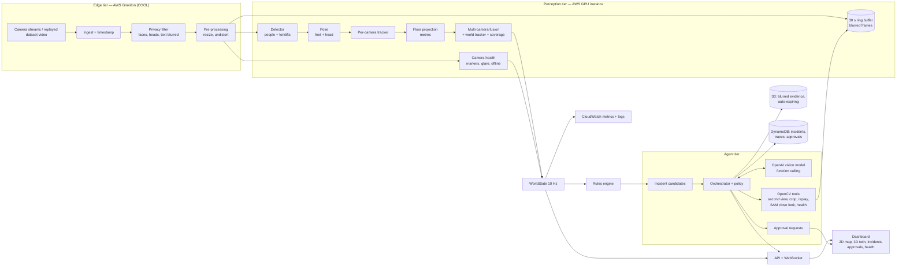

# Floorsight — project overview and build guide (start here)

Written 19 October 2026 for anyone joining the project with no prior context.
Facts are verified from the sources linked at the end. Plans, targets and estimates are labelled
as such. Prices and licenses were read on 19 October 2026; recheck before paying or submitting.

## 0. Read this first (added 20 October 2026)

### Where the idea comes from

The competition page lists the project areas the organisers especially welcome. Two of them
combine into Floorsight:

1. **"Real-time spatial digital twins"** — one of the organisers' suggested project areas.
   Floorsight keeps a live map and 3D model of a work floor, updated from its cameras.
2. **"Safety"** — in the organisers' list of welcomed domains ("healthcare, safety,
   accessibility, …"). People being hit by forklifts is a common and serious workplace hazard.

Put together: a live digital twin of a warehouse or factory floor whose purpose is preventing
forklift–person accidents, with an agent that checks each alert visually before acting (which also
fits the separate Agentic Vision award).

### Where OpenCV 5 is used

OpenCV 5.0.0 was released on 6 June 2026. The Python package we pin is
`opencv-python-headless==5.0.0.93` (the current 5.x release on PyPI). Every cloud run must record the
exact `cv2.__version__` in its receipt. "Status" says what exists today; "planned" means not built yet.

Checked on the GCP perception environment on 20 Oct (OpenCV pin check job): `cv2.__version__`
is `5.0.0`; it is the only OpenCV package installed; all four DNN engine choices exist
(`ENGINE_AUTO`, `ENGINE_NEW`, `ENGINE_CLASSIC`, `ENGINE_ORT`); these calls ran without error:
`imread`, `FaceDetectorYN`, `dnn.NMSBoxes`, MOG2, `findHomography`, `perspectiveTransform`,
`solvePnP`, `putText`, the line-segment detector, `HoughLinesP` and ORB features; the people
detector also ran on top of OpenCV 5. The module column names OpenCV's C++ modules. In Python the functions keep their names
(`cv2.solvePnP`, `cv2.findHomography`); there is no `cv2.geometry` attribute.

| Component | OpenCV 5 functions | OpenCV 5 module | New or changed in 5? | Status |
|---|---|---|---|---|
| Video input | `VideoCapture`, `VideoWriter` | videoio | Changed: unsupported properties now return a negative value | In use (real clips, simulator) |
| Privacy: faces | `FaceDetectorYN` (YuNet) | objdetect | Changed: the DNN face detector is the main-module face detector; the old Haar and HOG detectors moved out to contrib | In use |
| Privacy: blur, pixelation | `GaussianBlur`, `resize` | imgproc | Changed: nearest-neighbour resize follows a new convention | In use |
| Detector (people, forklifts) | `dnn.readNet` + ONNX model, `dnn.NMSBoxes` | dnn | **New in 5: rewritten inference engine** (tried first, falls back to the classic one; much wider ONNX support; CPU-only for now, with an ONNX Runtime option) | NMS in use; the detectors themselves still run in PyTorch, moving to OpenCV DNN is planned |
| Moving-object cues | `createBackgroundSubtractorMOG2` | video | Not new | In use |
| Camera placement from floor markers | `aruco.ArucoDetector`, `solvePnP` | objdetect + **geometry** | **New in 5: `solvePnP`, `findHomography`, `triangulatePoints` now live in the new `geometry` module** (old `calib3d` split up) | In use (simulator) |
| Floor map from a camera | `findHomography` (+ `perspectiveTransform` from core), line-segment detector, `fitLine` | **geometry** | **New module in 5** | In use (simulator); real-clip floor map built 20 Oct from vanishing points and two size references (see `docs/Floor-Map-Retest-20261020.txt`) |
| Lens calibration | `calibrateCamera` | **calib** | **New module in 5** (split from `calib3d`) | Prototype tool exists; not yet run on real cameras |
| Vehicle footprint | `minAreaRect`, `convexHull` (plus `pointPolygonTest` for distances) | **geometry** | **Moved into `geometry` in 5** (from imgproc) | In use (real-clip floor re-test, 20 Oct) |
| Forklift danger zones (stopping distance, tail swing, blind zone behind the load) | `fillPoly`, `warpPerspective`, `findContours` | imgproc | Not new | In use (real clips, 20 Oct): 64 sampled versions per frame warped onto one floor, "likely" and "possible" outlines (see `docs/Danger-Zone-20261020.txt`) |
| Multi-camera 3D | `triangulatePoints`, reprojection checks | **geometry** | New module in 5 | Planned |
| 3D scan of a site (optional) | TSDF fusion, odometry, point-cloud input/output | **ptcloud** | **New module in 5** (partly from contrib `rgbd`) | Optional, planned |
| Tracking | `KalmanFilter` | video | Not new | In use (simulator) |
| Overlay labels | `putText` | imgproc | Changed: text now renders with an embedded TrueType font; new `FontFace` | In use |
| Edge pre-processing on Graviton (COOL path) | resize, colour conversion, blur | core / imgproc | Press reports a new hardware layer in 5 with Arm KleidiCV acceleration (not checked against official notes) | Planned |

Sources: the official OpenCV 5.0.0 release (GitHub) and its "OpenCV 4 to 5 migration" guide.
The press items are marked as such.

Note: OpenCV 5's new DNN engine is CPU-only. GPU inference uses either the classic engine with a
CUDA build or OpenCV's ONNX Runtime option; section 12 covers the fallback.

### The 3D twin needs no VR

The 3D digital twin is a normal web page. It opens in any browser on a laptop, tablet or phone,
and you turn and zoom it with the mouse or your fingers. No headset or special hardware is needed.
The same 3D file (GLB) also opens in ordinary 3D viewers.

## Contents

0. Read this first: where the idea comes from, where OpenCV 5 is used, the 3D view needs no VR

**Part 1 — Context**
1. The 60-second version
2. Words you will see
3. The competition
4. Why this idea, and its weaknesses

**Part 2 — What we build (written as if nothing is coded yet)**
5. The product
6. Architecture
7. Component-by-component build instructions
8. AWS deployment
9. Evaluation: how we prove it works
10. The video, report and submission package
11. Task list and schedule
12. Risks and fallbacks

**Part 3 — What we already have to borrow from**
13. Footage and datasets
14. The existing Floorsight prototype
15. Our company's 3D pipeline (exo-ego-4d) and earlier 3D work

**Part 4 — Practical**
16. Open decisions (Anish)
17. How a new team member can start today
18. References

---

# Part 1 — Context

## 1. The 60-second version

- **What:** we are entering the **OpenCV AI Competition 2026, powered by AWS**.
  Deadline: **26 Oct 2026, 11:45 pm US Pacific = 27 Oct, 12:15 pm India time.**
- **Our entry:** **Floorsight**, a safety system for warehouses and factories. It turns the
  cameras a site already has into a live map, and a live 3D model, of where every person and
  forklift is, in metres. It catches dangerous moments (a person too close to a moving forklift,
  someone walking in the forklift lane, a blocked exit). An AI agent double-checks each alert
  with more camera evidence before acting, and a human approves anything serious. Faces and
  other identifying details are removed first.
- **How we win:** deep, honest OpenCV 5 work; an agent whose actions are driven by what the
  cameras see; real footage; privacy as a headline feature; a clean AWS deployment; a
  clear 5-minute video.
- **Three prizes we target:** the main prize, the Agentic Vision award, and (if time allows) the
  Best Use of COOL award.

## 2. Words you will see

| Word | Meaning here |
|---|---|
| OpenCV | The most widely used open-source computer-vision library. Version 5 is required |
| AWS | Amazon Web Services, Amazon's cloud. A meaningful part of the entry must run there |
| Graviton | Amazon's own Arm-based server chips |
| COOL | "Cloud-Optimized OpenCV Library": a faster OpenCV build for Graviton, sold on AWS Marketplace |
| Calibration | Working out where a camera is and how it sees, so a pixel can be turned into a floor position in metres |
| Homography | A 3×3 matrix that maps image points on the floor to floor-plan coordinates |
| Detection | A box around a person or forklift in one camera image |
| Pose / keypoints | Body joints (ankles, knees, head…) found by a pose model |
| Track | One person or forklift followed over time, with an anonymous number |
| Seen / estimated / out of view / lost | Whether a dot is confirmed by a camera now, a best guess, in a spot no camera covers, or missing in a covered area |
| Near-miss | A person and a moving forklift getting dangerously close. Rule since 20 Oct, measured on the floor: the forklift is moving and the person is inside its stopping or tail-swing zone, or inside its blind zone while it drives load-first, or within 0.8 m; it must hold for 3 frames in a row |
| Danger zone | The floor a moving forklift will cover before it can stop (red), where its rear swings out in a turn (magenta), and the floor a tall load hides from the driver (blue), each drawn from 64 sampled variations with a "likely" and a "possible" outline |
| Recall | Share of real people and forklifts correctly shown on the map |
| False dot | A dot on the map where nobody is |
| Agent | An AI program that decides what to do next and calls tools ("look through camera 3") |
| PII | Personally identifiable information: faces, name badges, text |
| SAM | "Segment Anything Model" (Meta): draws the exact outline of an object |
| GLB | A standard single-file 3D scene format that browsers can display |
| Digital twin | A live 3D copy of a real place, kept up to date from sensors |
| VGGT | A Meta model that estimates camera positions and room shape from ordinary images |
| ONNX | A standard file format for trained AI models, which OpenCV can run |

## 3. The competition

**Organisers:** sponsored by Amazon Web Services; run by the OpenCV Foundation on Devpost.
About 5,160 people have signed up. Judges include **Gary Bradski, the founder of OpenCV**, and
Phil Nelson (OpenCV).

**Hard requirements**
1. OpenCV 5 must do real image or video work.
2. A meaningful component must run on AWS.

**Prizes**

| Prize | Amount |
|---|---|
| 1st / 2nd / 3rd overall | $5,000 / $3,000 / $2,000 |
| Agentic Vision Award | $1,000 |
| Best Use of COOL Award | $1,000 |

The two $1,000 awards are optional "focus paths"; by our reading they can be won on top of a
main prize. Recheck on the rules page.

**Main prize scoring:** technical execution — correctness and depth of the OpenCV 5
implementation, architecture, reliability, evaluation (30%) · innovation (20%) · real-world impact
(20%) · user experience (10%) · documentation and presentation (10%) · cloud delivery,
reproducibility, observability, security and responsible use (10%).

**Agentic Vision Award:** the agent must use OpenCV 5 tools in a multi-step perception → decision
→ action loop, and image or video results must change a later plan, tool call, action or request
for human approval. A chatbot explaining a fixed result does not count. Scoring: OpenCV 5 + agent
integration 30% · orchestration and appropriate autonomy 25% · task effectiveness and evaluation
20% · failure handling, observability, security, human control 15% · UX/docs/demo 10%.
Extra evidence required: an agent workflow diagram; a trace showing OpenCV output changing a later
decision; evaluation of task success, failure handling, observability and human control.

**Best Use of COOL Award:** COOL must execute the core image/video workload on Graviton (or the Arm
part of a documented hybrid). Scoring: verified COOL on Graviton 30% · architecture 25% · measured
performance/cost gain vs a baseline 20% · innovation 15% · reproducibility 10%. Extra evidence: COOL
version and instance configuration; reproducible method, inputs, baselines and results.
COOL costs roughly 4–6 cents per hour on top of the server, with a 7-day free trial.

**What we must submit**
1. Technical report: problem, users, architecture, OpenCV 5 implementation, AWS deployment,
   evaluation, limitations, responsible use.
2. Code repository or archive the judges can access (need not be open source).
3. Pinned dependencies plus build, deployment and test instructions.
4. Architecture diagram showing OpenCV 5 and AWS components (and agent / COOL parts).
5. A working web endpoint, or a live screen-share demo arranged with the judges.
6. A video of at most 5 minutes showing the team, the app working, its architecture and its
   principal results (public or unlisted).
7. Evaluation evidence, including failure cases and limitations.

**The rule that shapes the design:** judges may reject an entry that "creates material safety,
privacy, security, discrimination, or surveillance risks without appropriate safeguards", uses data
without rights or consent, or misrepresents results or the role of human review. Floorsight is a
camera system, so privacy safeguards and honest numbers are essential.

The organisers especially welcome "safety" and "real-time spatial digital twins"; we cover both.

## 4. Why this idea, and its weaknesses

**Strengths**
1. Real problem: collisions between forklifts and people are a well-known workplace hazard.
2. A natural fit for the Agentic Vision award: the agent looks again before acting.
3. Honesty as a feature: it shows blind spots, marks guesses as guesses, refuses weak alarms.
4. Privacy by design, which the rules effectively require.
5. A 3D digital twin, which the organisers explicitly ask for.

**Weaknesses to manage**
1. Warehouse-safety cameras are a common hackathon theme; we must stand out through the agent,
   the honesty, the 3D twin and the evaluation.
2. Real footage with ground truth is scarce; most accuracy numbers will come from photorealistic
   simulated scenes, plus a small hand-labelled real set.
3. Eight days is tight for two people. The task list (section 11) includes a cut order.

---

# Part 2 — What we build

## 5. The product

**Users:** a site safety manager (watches the dashboard, approves actions) and a floor supervisor
(receives alerts).

**What it does**
1. Shows a live 2D floor map and a live 3D model of the site with every person and forklift.
2. Shades areas no camera can see; people who walk into them are "out of view", not "gone".
3. Detects: near-misses (person ↔ moving forklift), people in forklift lanes, vehicles in
   walkways, blocked exits, people in restricted zones, camera faults (knocked, blocked, glare,
   offline).
4. Every alert goes to an agent that collects more visual evidence, decides, and explains why.
5. A human approves consequential actions: notifying people, changing rules, re-aligning a camera.
6. Privacy first: faces, heads and text are blurred before anything is analysed, stored or sent;
   the system keeps positions, not video; evidence expires.

**Principles (apply to every component)**
1. **Privacy first:** nothing unblurred leaves the privacy filter.
2. **Measured, not claimed:** every number in the report comes from a script anyone can rerun.
3. **The agent verifies; it never invents:** it cannot create or move people on the map.
4. **Honest uncertainty:** "insufficient evidence" is never shown as "safe".
5. **Ground truth only in evaluation:** the live system never reads answer files.

## 6. Architecture

### 6.1 Diagram



### 6.2 Components at a glance

| # | Component | Runs on | Main technology | Input → output |
|---|---|---|---|---|
| C1 | Ingest and replay | Edge (Graviton) | OpenCV `VideoCapture`, ffmpeg | Camera/video → timestamped frames |
| C2 | Privacy filter | Edge (Graviton, COOL) | OpenCV YuNet, PP-OCR text detector, blur | Raw frame → blurred frame + privacy stats |
| C3 | Calibration and site model | Setup tool + perception | OpenCV ArUco, `solvePnP`, `findHomography` | Site plan + images → camera models |
| C4 | Detector | GPU | YOLOX (ONNX) via OpenCV DNN | Frame → people/forklift boxes |
| C5 | Pose | GPU | RTMPose (ONNX) | Person box → 17 keypoints |
| C6 | Per-camera tracker | GPU host CPU | ByteTrack-style, OpenCV Kalman | Boxes → per-camera tracklets |
| C7 | Floor projection, fusion, world tracker, coverage | GPU host CPU | OpenCV geometry, SciPy Hungarian | Tracklets → WorldState (tracks in metres) |
| C8 | Camera health | GPU host CPU | ArUco re-detection, histograms | Frames → health status, fault events |
| C9 | Rules engine | Perception host | Python, OpenCV `pointPolygonTest` | WorldState → incident candidates |
| C10 | Agent orchestrator | Agent container | OpenAI API (function calling), policy code | Incident → tool calls → decision + trace |
| C11 | SAM close-look tool | GPU | SAM 2 | Incident frames → exact masks, true gap |
| C12 | API and dashboard | Web container | FastAPI, WebSocket, three.js | State → UI |
| C13 | 3D twin builder | Build step | trimesh (GLB export), three.js | Site plan → site GLB |
| C14 | Storage, retention, security | AWS managed | S3, DynamoDB, Cognito, IAM | Evidence, incidents, access control |
| C15 | Observability | AWS managed | CloudWatch | Metrics, logs, alarms |
| C16 | COOL benchmark | Graviton + x86 | COOL vs pip OpenCV | Speed and cost comparison |

### 6.3 Data contracts (define these first; every component speaks them)

Use Python `pydantic` models, export JSON Schema, version them (`schema_version`).

| Contract | Key fields |
|---|---|
| `FramePacket` | camera_id, frame_index, t (seconds, one shared clock), width, height, privacy {applied, faces, heads, text_regions, failed}, image |
| `Detection2D` | camera_id, t, cls (person/forklift/pallet), bbox, score, keypoints[17] (x, y, conf) |
| `FloorObservation` | camera_id, t, cls, xy_m, sigma_m, footprint_m, contact_visible, source_bbox |
| `Track` | track_id (anonymous), cls, x, y, vx, vy, heading, sigma_m, state (seen / estimated / out_of_view / lost), camera_ids, first_seen_t, last_seen_t |
| `CameraHealth` | camera_id, status (ok / moved / blocked / glare / offline / needs_human), fps, last_frame_t, markers_visible, calib_error_m |
| `WorldState` | t, tracks[], cameras[], coverage_version, latency_ms |
| `Incident` | incident_id, type, t_start, t_end, zone_id, track_ids, facts {distance_m, closing_mps, …}, status (candidate / investigating / confirmed / insufficient_evidence / rejected / escalated / resolved) |
| `AgentStep` | incident_id, step, tool, args, result (structured), evidence_refs, rationale, t |
| `ApprovalRequest` | approval_id, incident_id, action, payload, status (pending / approved / denied), decided_by, t |

### 6.4 Site plan file (one JSON per site)

```jsonc
{
  "site_id": "factory_eskisehir_cam9_cam14",
  "units": "m",
  "floor": {"polygon": [[0,0],[40,0],[40,25],[0,25]]},
  "zones": [
    {"id": "walkway_1", "kind": "walkway",       "polygon": [[...]]},
    {"id": "lane_1",    "kind": "forklift_lane", "polygon": [[...]]},
    {"id": "exit_b",    "kind": "exit",          "polygon": [[...]]},
    {"id": "cold_room", "kind": "restricted",    "polygon": [[...]]}
  ],
  "obstacles": [{"id": "rack_a", "polygon": [[...]], "height_m": 3.0}],
  "cameras": [{
    "id": "cam9", "source": "rtsp://… or file path", "width": 1920, "height": 1080, "fps": 24,
    "K": [[fx,0,cx],[0,fy,cy],[0,0,1]], "dist": [k1,k2,p1,p2,k3],
    "R": [[...]], "t": [...],              // or "H_floor" for homography-only cameras
    "calibration_quality": "markers | supplied | clicked_points"
  }],
  "markers": [{"id": 7, "corners_m": [[x,y],[x,y],[x,y],[x,y]]}],
  "vehicle_models": {"forklift": {"length_m": 2.0, "width_m": 1.1, "height_m": 2.1}}
}
```

### 6.5 Repository layout

```
floorsight/
  contracts/        pydantic models + exported JSON Schemas
  sites/            one site plan per dataset/site
  edge/             C1 ingest/replay, C2 privacy filter, pre-processing
  perception/       C3 calibration, C4 detector, C5 pose, C6 2D tracker, C7 fusion, C8 health
  rules/            C9
  agent/            C10 orchestrator, policy, tools, OpenAI client; C11 SAM tool
  api/              C12 FastAPI + WebSocket
  web/              dashboard (2D map, 3D twin viewer, incidents, approvals, health)
  twin/             C13 GLB builder
  eval/             evaluation harness, labelling tool, metrics, plots
  bench/            C16 COOL benchmark
  infra/            Terraform (or CDK) for AWS, Dockerfiles, docker-compose
  models/           model download scripts + checksums (no weights in git)
  docs/             report, diagrams, runbook
  tests/
```

### 6.6 Technology choices

| Area | Choice | Why |
|---|---|---|
| Language | Python 3.11 | Fast to build; OpenCV, models and AWS SDK all native |
| Vision | OpenCV 5.x (pinned exact version) | Required; used for geometry, video, DNN, privacy, tools |
| Model runtime | OpenCV DNN for YOLOX, YuNet, PP-OCR; ONNX Runtime GPU where OpenCV DNN lacks an op or CUDA | YOLOX and YuNet are in the OpenCV model zoo, so they run in OpenCV DNN |
| Training | PyTorch + the YOLOX repository (training only, on a cloud GPU) | Forklift class needs fine-tuning |
| Agent | OpenAI API with function calling; model name in config | Owner's choice; vision-capable |
| Backend | FastAPI + uvicorn, WebSocket | Simple, async, typed |
| Frontend | Plain TypeScript/JS + three.js (3D) + Canvas/SVG (2D map) | No heavy framework needed |
| 3D twin | trimesh to write GLB; three.js GLTFLoader to show it | Standard formats |
| Infra | Docker, docker-compose on EC2; Terraform for AWS resources | Repeatable deploy (judged) |
| AWS | EC2 GPU, EC2 Graviton + COOL, S3, DynamoDB, Cognito, CloudFront, CloudWatch, Budgets | See section 8 |

Note: function names in this guide are from OpenCV's Python API; OpenCV 5 reorganised some
modules (for example camera calibration), so check each name against the installed 5.x docs on day 1.

## 7. Component-by-component build instructions

Each component lists **build steps** and **done when** (an acceptance test).

### C1 — Ingest and replay

Build steps:
1. One reader per camera: `cv.VideoCapture` for files or RTSP; stamp each frame with the shared
   clock time `t` (for datasets: `frame_index / fps + camera_offset`).
2. Replay mode for the demo: read dataset videos at real time, synchronised across cameras;
   loop when finished; inject faults on demand (drop a camera, add glare, shift a camera) for tests.
3. Bounded queues; if processing falls behind, drop the oldest frame and count the drop (never
   build up delay).
4. Publish `FramePacket`s to the privacy filter (same process or over a local socket / ZeroMQ).

Done when: four 1080p streams replay in sync for 10 minutes with drift under one frame and a drop
counter that reads zero at normal load.

### C2 — Privacy filter (runs first, on the edge tier)

Build steps:
1. Face detection with YuNet (`cv.FaceDetectorYN`) at full frame resolution.
2. Head fallback: after pose (C5) is available, blur an ellipse around head keypoints
   (nose, eyes, ears) for every person, so small and turned-away faces are covered. On the edge
   tier, use the person box's top 20% as a fallback head region until pose arrives.
3. Text and badge blur: PP-OCR text detector from the OpenCV model zoo; blur detected text regions.
4. Blur method: pixelate then Gaussian blur, with a 30–50% padding around each region.
5. Fail closed: if any step errors, output a black frame and raise a health alert. Never pass raw pixels.
6. Record per-frame privacy stats (counts, failures) into the `FramePacket`.
7. Only blurred frames are stored, shown, sent to OpenAI or kept in the replay buffer.

Done when: on a hand-labelled set of real frames with faces (target ≥ 100 faces), at least 95% of
faces taller than 20 px are covered by blur (target, to be measured and reported honestly,
including misses by face size); a forced error produces a black frame and an alert.

### C3 — Calibration and site model

Three ways, depending on the source:
1. **Printed floor markers (our own footage):** `cv.aruco.ArucoDetector` finds markers whose floor
   corners are known; `cv.solvePnP` gives each camera's pose; lens intrinsics from a ChArUco board
   (`cv.calibrateCamera`) or the phone's metadata.
2. **Supplied calibration (NVIDIA warehouses):** convert their `calibration.json`
   (intrinsics, extrinsics, homographies) into our site plan.
3. **Clicked floor points (factory clips, no calibration):** click ≥ 6 floor points per camera
   matched to the published floor plan (lane corners, line ends); `cv.findHomography` with RANSAC;
   mark `calibration_quality: clicked_points` and treat distances as approximate.

Also: compute each camera's visible floor area (project floor grid cells into the image, test
against image bounds and rack occlusion) to build the coverage map.

Done when: reprojecting known floor points into each camera lands within 10 px (markers/supplied)
or 25 px (clicked); the coverage map matches what the camera images visibly show.

### C4 — Detector (people and forklifts)

Build steps:
1. Start from YOLOX pretrained on COCO (people already work). YOLOX is in the OpenCV model zoo.
2. Fine-tune a forklift (and pallet truck, pallet) class on a cloud GPU using:
   LOCO (real warehouse photos, CC0) + NVIDIA simulated warehouse frames (CC BY 4.0) + a few
   hundred auto-labelled factory frames (SAM-assisted labels, checked by eye).
3. Export to ONNX; run with `cv.dnn.readNetFromONNX` (CUDA backend if OpenCV is built with CUDA;
   otherwise ONNX Runtime GPU for this model only).
4. Batch the four camera frames together; input size 640 (tune for speed).
5. Keep a held-out set (never trained on) for evaluation.

Done when: on held-out frames, person detection AP50 ≥ 0.85 and forklift AP50 ≥ 0.75 (targets);
four cameras at ≥ 10 frames per second each on the GPU instance.

### C5 — Pose (feet and head)

Build steps:
1. RTMPose (ONNX) on each person box crop; 17 COCO keypoints.
2. Foot point = midpoint of visible ankles; if ankles are hidden (behind a forklift or rack),
   estimate from knees and body height and mark `contact_visible = false` (raises uncertainty).
3. Head keypoints feed the privacy head blur.

Done when: on hand-labelled frames, foot points are within 15 px of the labelled feet for ≥ 85% of
visible people (target).

### C6 — Per-camera tracker

Build steps:
1. ByteTrack-style association: Kalman-predicted boxes (`cv.KalmanFilter`), match high-confidence
   detections first, then low-confidence ones, by IoU; Hungarian assignment.
2. Keep tracklets alive briefly through short occlusions.

Done when: on NVIDIA simulated scenes, identity switches per camera per minute are low enough to
keep the world tracker stable (report the number).

### C7 — Floor projection, fusion, world tracker, coverage

Build steps:
1. Project each foot point to the floor: undistort (`cv.undistortPoints`), then homography or
   ray–floor intersection. For forklifts, fit an oriented box (2.0 × 1.1 m) to the projected
   lower outline (`cv.minAreaRect` on projected points) to get centre and heading.
2. Per-observation uncertainty from the camera's metres-per-pixel at that spot; larger when
   contact is hidden or the box is cut by the image edge.
3. Fuse across cameras: group observations of the same object (gated by distance and class),
   inverse-variance weighted position; flag conflicts instead of averaging them away.
4. World tracker: Kalman filter per track in metres; Hungarian assignment; confirm after several
   hits; class by majority vote with forklift/person size checks.
5. States:
   - **seen** — supported by a camera within 0.2 s and uncertainty ≤ 0.35 m,
   - **estimated** — weak or partial support, or up to ~0.8 s without support,
   - **out_of_view** — predicted into a blind area (kept up to 20 s, uncertainty grows),
   - **lost** — in a covered area but unsupported; dropped after ~3 s.
6. **Stopped-person hold:** when a tracked person stops, keep them seen only while the pixels at
   their spot show something unexplained by moving objects and unchanged in shape over ~0.6 s
   (this exact test cut false holds from 35% to 4% in our prototype measurements).
7. Coverage map: grid of floor cells (0.5 m), count of cameras that see each cell.

Done when (targets on NVIDIA simulated scenes): recall ≥ 90%, median position error ≤ 0.25 m,
false dots ≤ 0.25 per update, ≥ 10 map updates per second, p95 latency ≤ 300 ms.

### C8 — Camera health

Build steps:
1. Every few seconds, re-detect floor markers (or compare against a reference image with ORB
   features + `cv.findHomography`); if the floor error exceeds 0.15 m three times in a row →
   status `moved`.
2. Glare: share of saturated pixels and loss of texture in a region → `glare`.
3. Blocked: sudden loss of edges/texture across most of the frame → `blocked`.
4. Offline: no frame for 0.5 s → `offline`.
5. Re-alignment: estimate the new pose from markers/features; propose it to the agent (needs approval).

Done when: injected faults (knock, glare, cover, unplug) are each detected within 3 s with no
false fault in 10 minutes of normal video.

### C9 — Rules engine

Rules (each produces an `Incident` candidate with facts):
1. **Near-miss:** distance from the person point to the forklift's oriented box < 0.8 m and
   closing speed > 0.2 m/s, with both tracks recently seen; debounce 1 s.
2. **Person in forklift lane** longer than N seconds (default 3 s) (`cv.pointPolygonTest`).
3. **Forklift in walkway.**
4. **Blocked exit:** a static object in an exit zone for more than T seconds (default 20 s).
5. **Person out of view in a restricted zone** (for example a cold room) longer than T seconds.
6. **Camera fault** from C8.
7. **Plain-language rules:** "Alert me if anyone stands in the forklift lane for more than 5
   seconds" → parsed by the LLM into a zone rule → shown on the map → a human confirms.

Done when: unit tests cover each rule with synthetic tracks (including just-below and just-above
thresholds), and on NVIDIA simulated scenes, near-misses derived from ground truth are detected
with recall ≥ 90% and zero duplicates.

### C10 — Agent orchestrator (OpenAI)

The loop, per incident:
1. **Context:** the orchestrator (normal code, not the LLM) assembles facts (distances, speeds,
   track states, camera health) and the list of cameras that cover the spot.
2. **Plan:** the OpenAI model receives the facts plus blurred image crops and chooses the next
   tool through function calling, or a decision.
3. **Act:** the tool runs OpenCV code server-side and returns structured results plus blurred images.
4. **Repeat** up to 6 steps or 20 seconds.
5. **Policy check (code, not LLM):** "confirmed" is allowed only with measured geometric support
   (track geometry or SAM gap) **and** at least one independent visual support (second camera or
   close look). Otherwise the outcome is "insufficient evidence", never "safe".
6. **Human control:** consequential actions create an `ApprovalRequest`; the server refuses the
   action until a person approves it in the dashboard.
7. **Trace:** every step (tool, arguments, result, rationale, time, cost) is stored and shown.
8. **Fallback:** if OpenAI is slow or down, a deterministic policy decides and the decision is
   labelled as such.

Tools (each is OpenCV-backed):

| Tool | What it does | Approval |
|---|---|---|
| `cameras_covering(point)` | Which cameras see the spot and their health | No |
| `second_view(camera, point, radius)` | Projects a person-sized column into another camera; measures foreground support; returns a blurred crop | No |
| `sharper_crop(camera, point, radius)` | Higher-resolution blurred crop of the spot | No |
| `replay(camera, t_from, t_to)` | Keyframes from the 30 s ring buffer plus track history | No |
| `close_look(incident)` | SAM 2 masks → exact person–forklift gap in metres, "inside lane" yes/no | No |
| `camera_health(camera)` | Markers, calibration error, glare, fps | No |
| `request_realignment(camera)` | Proposes a new camera pose | Yes |
| `notify(audience, message)` | Sends an alert (sandboxed in the demo) | Yes |
| `propose_rule(text)` | Turns a recurring pattern into a new zone rule | Yes |
| `close_incident(decision, reason)` | Ends the investigation | No (policy-checked) |

Done when: on the evaluation incident set, zero false confirmations, ≥ 90% of true incidents
confirmed (targets), every decision has a complete trace, and approvals are enforced server-side
(a test that calls a consequential tool without approval must fail).

### C11 — SAM close-look tool

Build steps:
1. Prompt SAM 2 with the person and forklift boxes on the incident keyframes.
2. Project mask boundary points to the floor; compute the true minimum gap and lane membership.
3. Return numbers plus a blurred overlay image for the evidence page.

Done when: on 20 labelled incident frames, SAM gap estimates are within 0.15 m of hand
measurements (target); runs in under 2 s per incident on the GPU.

### C12 — API and dashboard

Backend: FastAPI with
- WebSocket `/ws/world` (WorldState at 10 Hz),
- REST: `/incidents`, `/incidents/{id}` (with trace and evidence links), `/approvals`
  (approve/deny), `/cameras`, `/rules`, `/health`,
- authentication on every route (Cognito or a server-checked judge access code).

Frontend pages:
1. **Live:** 2D floor map (zones, coverage shading, tracks coloured by state, forklift boxes with
   heading) and blurred camera thumbnails.
2. **3D twin:** the site GLB with live people (capsules or skeletons) and forklifts (boxes),
   camera frustums, coverage on the floor, blind areas shaded.
3. **Incidents:** list → detail page with timeline, evidence images, the agent's step-by-step
   trace, decision, and approvals.
4. **Approvals queue.**
5. **Health:** cameras, fps, latency, privacy status (faces blurred, failures), agent cost.
6. **Rules:** type a rule in plain language → see it drawn on the map → confirm.

Done when: a first-time user can find "what happened at 1:48, why the agent decided that, and
what evidence it used" in under 30 seconds (test it on someone).

### C13 — 3D twin builder

Build steps:
1. Script reads the site plan → builds meshes with trimesh: floor (with lanes and zones painted
   as a texture), racks extruded to their heights, walls, exit markers, camera frustums.
2. Export one GLB per site.
3. three.js viewer loads the GLB and adds live objects from the WebSocket.
4. Optional: a real 3D scan of the site from camera footage using the exo-ego-4d recipe
   (section 15) — only if the license decision on VGGT allows it.

Done when: the 3D view runs at ≥ 30 fps in a normal browser and every live object sits where the
2D map says it is.

### C14 — Storage, retention, security

1. S3 bucket: blurred evidence only, private, encrypted, lifecycle deletion (for example 7 days).
2. DynamoDB: incidents, traces, approvals; track snapshots with a time-to-live.
3. Access: Cognito (or server-checked access code) for the dashboard; IAM least privilege;
   no SSH (use SSM Session Manager); secrets (OpenAI key) in AWS Secrets Manager.
4. Audit log: who viewed evidence and who approved what.
5. Only blurred crops go to OpenAI; state this in the UI and report.

### C15 — Observability

CloudWatch metrics: fps per camera, end-to-end latency p50/p95, dropped frames, track counts by
state, incidents by type and outcome, agent steps and latency, OpenAI cost, privacy-filter
failures. Logs from every container. Alarms: camera offline, latency above budget, privacy
failure. A CloudWatch dashboard screenshot goes into the report and video.

### C16 — COOL benchmark (optional third prize)

1. Workload: the edge tier's OpenCV stages (decode, resize, undistort, privacy blur, background
   model) on four 1080p streams for a fixed set of frames.
2. Three setups on the same input: pip OpenCV on an x86 instance (for example c7i.xlarge), pip
   OpenCV on Graviton (c8g.xlarge), COOL on Graviton (c8g.xlarge).
3. Measure frames per second, per-frame p50/p95 latency, CPU utilisation and cost per million
   frames; three repetitions; publish the script, inputs, versions and results.
4. In the architecture, the edge tier really runs COOL on Graviton (that is what the award checks).

Done when: a reproducible table and chart, and evidence (version, instance, logs) that COOL ran
the edge workload.

## 8. AWS deployment

**Resources**

| Resource | Purpose |
|---|---|
| EC2 GPU instance (g5.xlarge or g6.xlarge, 24 GB GPU) | Detector, pose, SAM, tracker, rules, agent, API |
| EC2 Graviton instance (c8g.xlarge) with the COOL Marketplace image | Edge tier: ingest, privacy filter, pre-processing |
| S3 | Blurred evidence with lifecycle deletion; model files |
| DynamoDB (on-demand) | Incidents, traces, approvals, track snapshots (TTL) |
| CloudFront (+ ALB or the instance) | HTTPS judge link |
| Cognito or access code | Login |
| Secrets Manager | OpenAI key |
| CloudWatch | Metrics, logs, alarms, dashboard |
| AWS Budgets | Email warnings at 50% / 80% / 100% of a monthly limit |
| Terraform | Everything above as code, so it can be recreated |

**Day-1 gotcha:** new AWS accounts often have a quota of zero for GPU instances. Request a quota
increase for "Running On-Demand G and VT instances" on day 1; it can take a day.

**Approximate costs** (on-demand, us-east-1; confirm in the AWS pricing calculator)

| Item | Approx. price |
|---|---|
| g5.xlarge GPU | about $1.00 per hour |
| g6.xlarge GPU | about $0.80 per hour |
| c8g.xlarge Graviton | about $0.16 per hour, plus COOL about $0.04–0.06 per hour |
| S3, DynamoDB, CloudWatch, CloudFront | a few dollars for this project |

Budget guide: the build week at ~10 GPU-hours a day is roughly $60–80. The judging period
(27 Oct – 9 Nov) is the bigger decision:
1. keep the GPU running 24/7 (roughly $270–340 for two weeks), or
2. serve a clearly labelled "recorded run" mode from the cheap Graviton instance and switch on
   the GPU for live sessions on request, or
3. offer a live screen-share instead of a public endpoint (allowed by the rules).
Whatever we choose, the report must say exactly what the judge link shows.

**OpenAI cost:** a few cents per investigated incident (small images, few steps). Set a monthly
spending limit in the OpenAI dashboard.

## 9. Evaluation: how we prove it works

| Test | Data | Metrics | Notes |
|---|---|---|---|
| Tracking accuracy | NVIDIA simulated warehouses (exact 3D truth) | Recall, false dots per update, median/p90 position error, identity switches | Match predictions to truth within 0.75 m per frame (Hungarian) |
| Real tracking | NVIDIA real warehouses 026/027 | Same, on hand-labelled frames (~50 per camera) | Small sample; say so |
| Safety events | NVIDIA simulated (events derived from truth with the same rule) | Near-miss recall/precision, detection delay | Truth only in the evaluator |
| Real lane violations | Factory dataset test split: "safe walkway violation" (32 clips) vs "safe walkway" (25 clips) | Clip-level accuracy, precision, recall | Uses the dataset's own labels |
| Privacy | Hand-labelled real faces (own recording, factory frames; WILDTRACK if licensed) | % of faces covered, by face size; failures shown | |
| Agent | All incidents from the above | Confusion matrix (confirm / insufficient / reject vs truth), steps, time, cost; approval enforcement tests | |
| Robustness | Injected faults: knocked camera, glare, covered camera, dropped camera, frame drops | Detection time, effect on accuracy | |
| Speed | Live replay on AWS | Updates per second, p50/p95 latency, GPU/CPU use | |
| COOL | Section C16 | Speed and cost vs baselines | |

Rules for evaluation:
1. Every result file records the code version, model versions, config and scorer version.
2. Never tune on the test split; keep held-out scenes.
3. Show failure cases (images) next to the numbers.
4. Ground truth is read only by the evaluator, never by the live system (add a test for this).

Hand-labelling tool: a small OpenCV script (`cv.setMouseCallback`) to click feet and faces on
frames and save JSON, or CVAT.

## 10. The video, report and submission package

### 10.1 Video (maximum 5:00; target 4:45)

| Time | Shows | Notes |
|---|---|---|
| 0:00–0:15 | Real factory CCTV: forklift passes a worker (blurred). One line: "Forklifts and people share the same floor. Most sites already have cameras." | Hook |
| 0:15–0:35 | The team (faces on camera), and what Floorsight is in one sentence | Required: show the team |
| 0:35–1:30 | Live dashboard on the real NVIDIA warehouse: 2D map + 3D twin, people and forklifts moving, blind areas shaded, someone walks into a blind spot → "out of view" | The "wow" |
| 1:30–2:30 | A near-miss happens → the agent's trace step by step: second camera, SAM close look with the measured gap → confirmed → approval request → the human approves → alert sent | Agentic Vision evidence |
| 2:30–3:00 | Glare false alarm → second camera disagrees → rejected; a knocked camera → detected → re-alignment approved | Failure handling, human control |
| 3:00–3:15 | Privacy: before/after blur (on consenting footage), "positions, not video", expiry | Responsible use |
| 3:15–3:50 | Architecture diagram: edge on Graviton with COOL → GPU perception → rules → agent → dashboard; AWS services | Required: architecture |
| 3:50–4:35 | Results: tracking accuracy, real lane-violation accuracy, privacy coverage, agent confusion matrix, speed, COOL comparison; one or two failure cases | Required: principal results |
| 4:35–4:50 | Limitations and what's next | Honesty |

Production:
1. Record the dashboard with OBS Studio at 1080p; record narration separately.
2. Edit in DaVinci Resolve (free) or CapCut; add captions.
3. Upload to YouTube as unlisted; check it plays logged out.
4. Every number shown must match the report.

### 10.2 Technical report (outline)

1. Problem and users
2. What Floorsight does (one figure)
3. Architecture (diagram) and data contracts
4. OpenCV 5 implementation, component by component
5. AI models and training data (with licenses)
6. The agent: loop, tools, policy, human control, trace example
7. AWS deployment (resources, security, observability, cost)
8. Privacy and responsible use
9. Evaluation: datasets, metrics, results, failure cases
10. COOL benchmark (if done)
11. Limitations and future work
12. Reproducibility: build, deploy, test, evaluate
13. Credits and licenses (datasets, models)

### 10.3 Submission checklist

1. Report (PDF) and architecture diagram (PNG/SVG), plus the agent workflow diagram.
2. Code archive or repository with judge access; pinned dependencies; README with build,
   deploy, test and evaluation commands.
3. Working judge link (or screen-share arrangement) with login instructions.
4. Video link (unlisted, plays when logged out).
5. Evaluation folder with result files and failure-case images.
6. COOL evidence (version, instance, logs, results) if entering that award.
7. Agent traces if entering Agentic Vision.
8. License and credit list for all footage and models.
9. Submit by the evening of 26 Oct (India time), not at the deadline.

## 11. Task list and schedule

Two people: **Track A — Vision** and **Track B — Product and cloud**. Fill in names.
"♻" marks tasks where the existing prototype (section 14) can be reused to save time.
Estimates assume AI coding assistants and focused days.

| # | Task | Track | Est. | Depends on | Done when |
|---|---|---|---|---|---|
| 1 | AWS account safety, budget, GPU quota request | B | 1 h | — | Quota requested, budget alerts on |
| 2 | Repo skeleton, contracts, site-plan format ♻ | B | 0.5 d | — | Schemas exported, tests run |
| 3 | Download footage to cloud storage; site plans for NVIDIA 026/027 and factory | A | 0.5 d | 1 | Files + plans committed (no video in git) |
| 4 | OpenCV 5 environment (Docker) incl. GPU check | A | 0.5 d | 1 | Container runs YOLOX + YuNet on GPU |
| 5 | C1 ingest/replay ♻ | A | 0.5 d | 4 | Acceptance test passes |
| 6 | C2 privacy filter ♻ (YuNet exists) + text blur + fail-closed | B | 1 d | 5 | Acceptance test passes |
| 7 | C3 calibration loaders (markers ♻, NVIDIA, clicked) + coverage ♻ | A | 0.5 d | 3 | Reprojection test passes |
| 8 | C4 detector: COCO baseline running | A | 0.5 d | 4 | People detected on real footage |
| 9 | C4 forklift fine-tune (cloud GPU) | A | 1 d | 8 | AP targets on held-out set |
| 10 | C5 pose + foot points | A | 0.5 d | 8 | Foot-point test passes |
| 11 | C6 + C7 tracking, fusion, states, coverage ♻ | A | 1.5 d | 7, 10 | Targets on simulated scenes |
| 12 | C8 camera health ♻ | A | 0.5 d | 7 | Fault tests pass |
| 13 | C9 rules engine ♻ | B | 0.5 d | 2 | Rule tests pass |
| 14 | C10 agent orchestrator + tools + policy + approvals + trace ♻ | B | 1.5 d | 11, 13 | Agent tests pass |
| 15 | C11 SAM close-look tool | A | 0.5 d | 10 | Gap test passes |
| 16 | C12 API + dashboard (2D, incidents, approvals, health) ♻ | B | 1 d | 2 | Usability test passes |
| 17 | C13 3D twin builder + viewer | B | 1 d | 3 | 3D test passes |
| 18 | C14/C15 storage, security, observability | B | 0.5 d | 16 | Alarms fire on injected faults |
| 19 | AWS deploy with Terraform ♻ (prepared checklist exists) | B | 1 d | 1, 16 | Judge link works from outside |
| 20 | Evaluation harness + hand labels ♻ | A | 1 d | 11 | All result tables generated by script |
| 21 | C16 COOL benchmark (optional) | A | 1 d | 19 | Table + evidence |
| 22 | Report + diagrams | A+B | 1 d | 20 | Reviewed by both |
| 23 | Video | A+B | 1 d | 19, 20 | Under 5:00, plays unlisted |
| 24 | Final checks + submit | A+B | 0.5 d | all | Submitted on 26 Oct evening IST |

**Calendar**

| Date | Track A — Vision | Track B — Product and cloud |
|---|---|---|
| 19 Oct | 3, 4 | 1, 2 |
| 20 Oct | 5, 7, 8 | 6 |
| 21 Oct | 9 (training runs), 10 | 13, 16 |
| 22 Oct | 11 | 14 |
| 23 Oct | 11, 12, 15 | 17, 18 |
| 24 Oct | 20, 21 (optional) | 19 |
| 25 Oct | 22, 23 | 22, 23 |
| 26 Oct | 24 + buffer | 24 + buffer |

**Cut order if late:** COOL benchmark → SAM close look → real 3D scan (keep the plan-built 3D
model) → plain-language rules → WILDTRACK privacy test.

## 12. Risks and fallbacks

| Risk | Fallback |
|---|---|
| OpenCV 5 + CUDA build is slow or fails (the new DNN engine is CPU-only) | Use OpenCV 5's ONNX Runtime option or ONNX Runtime GPU directly for the big models; keep OpenCV for geometry, video, privacy, tools, YuNet |
| Forklift detector weak on real footage | Pseudo-label factory clips with SAM / an open-vocabulary detector and fine-tune again; COCO "truck" as an emergency fallback |
| NVIDIA real warehouses contain no forklifts | Use factory clips for real forklifts and NVIDIA simulated scenes for scored forklift results |
| Factory clips have no calibration | Clicked-point homography; use them for lane violations (inside/outside) rather than precise distances |
| GPU quota not granted in time | Develop on another GPU cloud we already use; deploy the GPU tier as soon as quota arrives |
| OpenAI slow or unavailable | Deterministic policy decides; labelled as such |
| VGGT license not acceptable | Build the 3D model from the site plan; use supplied or marker calibration |
| Running out of time | Follow the cut order; never cut privacy, evaluation honesty or the video |

---

# Part 3 — What we already have to borrow from

## 13. Footage and datasets

| Source | What | License | Use |
|---|---|---|---|
| Factory CCTV dataset (Önal & Dandıl, 2024) | 691 real clips (1–20 s, 1080p, 24 fps) from two ceiling security cameras in a working factory; forklifts, workers, painted walkway and forklift lanes; published floor plan; workers' permission obtained; labelled behaviours incl. "safe walkway violation" | CC BY 4.0 (credit required) | Real-world demo moment; real lane-violation evaluation |
| NVIDIA PhysicalAI-SmartSpaces | 2 real warehouses (4 cameras ≈ 110 MB and 7 cameras ≈ 180 MB, 60 s each, calibration included, no ground truth) + many photorealistic simulated warehouses with people, forklifts, pallet trucks and exact 3D boxes | CC BY 4.0 | Multi-camera real demo; scored evaluation; detector training |
| LOCO (TU Munich) | 39,101 real warehouse photos, 5,593 labelled (forklifts, pallet trucks, pallets, …) | CC0 | Forklift detector training |
| WILDTRACK (EPFL) | Real crowd, 7 calibrated cameras, clear faces | Not stated | Internal privacy testing only until confirmed |
| Own recording (optional) | 2–4 phones, printed markers, consenting volunteers, a trolley | Ours | Full installation flow; privacy test on real faces |

Not usable: SLAM datasets (moving cameras) and YouTube clips (copyright).

Sample images: `owner-review/footage/` in the project folder.


## 14. The existing Floorsight prototype

A working prototype was built on 16–17 October on a **simulated** warehouse (16 × 10 m, 4 ceiling
cameras, 3 minutes, 5 workers and a forklift, scripted incidents). It is a useful reference and
source of reusable code, but it uses an older detection method (differences from an empty-floor
image) that will not transfer well to real footage.

Reusable pieces: message contracts, site geometry, marker calibration, coverage map, tracker
states and the stopped-person hold, camera-health logic, rules, the agent's support policy and
approval flow, server and dashboard, AWS adapters and a prepared AWS checklist, scoring harness.

Latest measured results (fresh full run, 17 Oct, simulated footage only):

| Measure | Result | Target |
|---|---|---|
| Frames processed / dropped / errors | 1,800 / 0 / 0 | complete run |
| Map updates per second (full-resolution face blur on) | 9.98 | ≥ 9.5 |
| Recall | 86.9% | ≥ 90% — not met |
| Median position error | 0.084 m | < 0.20 m |
| False dots per update | 0.114 | < 0.25 |
| Scenario checks | 7 of 7 (incl. rejecting a glare false alarm) | 7 |
| Real near-misses confirmed by the agent | 3 of 3 | 3 |
| False confirmed incidents | 0 | 0 |
| Automated tests | 127 passed, 2 skipped | all pass |

Audits: the live system never reads the simulator's answer files. The prototype's privacy claims
were overstated (the face blur never fires on simulated people; it says "positions only" while
storing evidence crops). C2 is the planned replacement, not an implemented or validated fix.
Until real-frame coverage and forced-failure tests pass, describe privacy filtering as
installed but not validated. The current build stores positions and filtered evidence crops;
it does not store positions only. Preservation remains enabled, so expiry must not be claimed.

In these images, blue circles are tracks the system currently sees; orange circles are estimated
or out of view; green crosses are the simulator's true positions, drawn only for grading.


## 15. Our company's 3D pipeline (exo-ego-4d) and earlier 3D work

**exo-ego-4d** (Beyond-Frontier GitHub, private) takes several fixed room cameras and:
1. synchronises them by sound,
2. places every camera in 3D and measures its lens (VGGT),
3. finds every person and their 17 body joints in every camera,
4. matches who is who across cameras,
5. triangulates everyone in 3D, in true metres, on a level floor,
6. (prototype) exports one animated GLB: people as moving 3D bodies inside a coloured 3D scan of
   the real room, with camera positions, plus a viewer synced to the footage.

Its checks are exactly what judges value: hide one camera and predict what it sees from the
others; draw every 3D joint back onto every camera; fit on even seconds and judge on odd ones.
First shoot: reprojection about 0.3–0.6° median per camera, floor levelled to about 1 cm, size
accurate to about ±2%.

Earlier robotics work built real-room 3D scans (house rooms, a kitchen, a rooftop) with a recipe
of VGGT camera placement, depth estimation, surface fusion and hole filling. **No factory or
warehouse model exists yet.**

License cautions: VGGT's default weights and the GVHMR/SMPL-X body-fitting stage are
non-commercial. Use them only after a decision (section 16); otherwise build the 3D model from the
site plan (C13) and use supplied or marker calibration.

---

# Part 4 — Practical

## 16. Open decisions (Anish)

1. AWS account access and spending approval.
2. OpenAI API key and spending approval.
3. Judge link strategy for 27 Oct – 9 Nov (always-on GPU, recorded mode, or screen-share).
4. OK to use the CC BY footage with credit; yes or no on VGGT's non-commercial weights.
5. Whether to enter the COOL award (decide by 22 Oct).
6. Registration and team on Devpost; the registered team submits.

## 17. How a new team member can start today

1. Read the rules page and confirm registration, team members and the award opt-ins.
2. Do task 1: AWS admin user with MFA (not root), budget alerts, GPU quota request.
3. Pick a track (A or B) and start its first task from section 11.
4. Optional recording (if you can):
   - print 4–6 ArUco markers (A4 or larger), tape them flat on the floor, measure their positions,
   - mount 2–4 phones high, angled down, overlapping views, not moving,
   - film the empty floor for 10 seconds first,
   - one person walks a known route, another pushes a trolley, include a close pass,
   - get written consent from everyone filmed.
5. Heavy jobs (training, evaluation, video processing) run on cloud machines, not laptops.

## 18. References

**Competition**
- Overview: https://opencv26.devpost.com/
- Rules (rubrics, eligibility, responsible use): https://opencv26.devpost.com/rules

**COOL**
- AWS blog: https://aws.amazon.com/blogs/spatial/accelerating-opencv-on-graviton-the-cool-framework
- Marketplace listing: https://aws.amazon.com/marketplace/pp/prodview-igdweaoo6prb6

**Footage**
- Factory CCTV dataset: https://data.mendeley.com/datasets/xjmtb22pff/1 — paper: https://doi.org/10.1016/j.dib.2024.110791
- NVIDIA PhysicalAI-SmartSpaces: https://huggingface.co/datasets/nvidia/PhysicalAI-SmartSpaces
- LOCO: https://github.com/tum-fml/loco
- WILDTRACK: https://www.epfl.ch/labs/cvlab/data/data-wildtrack/
- NVIDIA AMC warehouse (real, 6 cameras; license not yet reviewed): https://catalog.ngc.nvidia.com/orgs/nvidia/-/resources/amc-nv-warehouse

**Models and tools**
- OpenCV: https://opencv.org/ — OpenCV model zoo (YOLOX, YuNet, PP-OCR): https://github.com/opencv/opencv_zoo
- OpenCV 5.0.0 release: https://github.com/opencv/opencv/releases/tag/5.0.0 — migration guide (module changes, new DNN engine): https://github.com/opencv/opencv/wiki/OpenCV-4-to-5-migration
- Python package: https://pypi.org/project/opencv-python-headless/5.0.0.93/
- YOLOX: https://github.com/Megvii-BaseDetection/YOLOX
- RTMPose: https://github.com/open-mmlab/mmpose/tree/main/projects/rtmpose
- SAM 2: https://github.com/facebookresearch/sam2
- VGGT: https://github.com/facebookresearch/vggt
- GVHMR (non-commercial; used in the exo-ego-4d prototype): https://github.com/zju3dv/GVHMR
- three.js: https://threejs.org/ — trimesh: https://trimesh.org/
- FastAPI: https://fastapi.tiangolo.com/
- OBS Studio: https://obsproject.com/ — DaVinci Resolve: https://www.blackmagicdesign.com/products/davinciresolve

**Our company's related work (Beyond-Frontier GitHub organisation)**
- exo-ego-4d (private): https://github.com/Beyond-Frontier/exo-ego-4d
- bynd-3d (public technical report): https://github.com/Beyond-Frontier/bynd-3d

Nothing in this document has been published or submitted.
